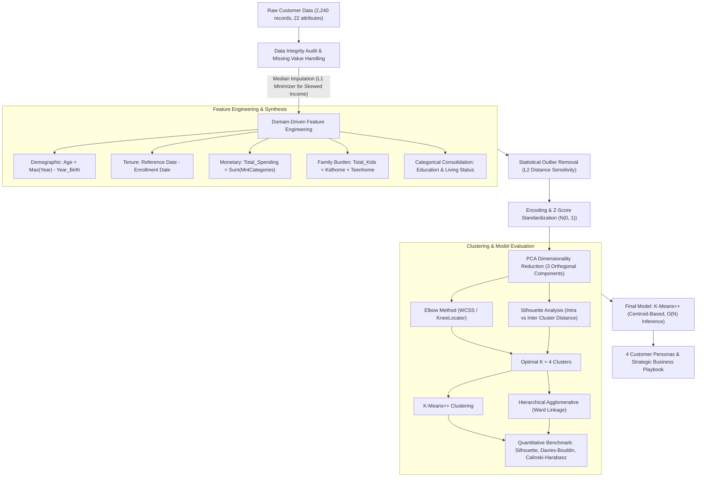

# 🛒 SmartCart™ — Customer Segmentation & Behavioral Intelligence Engine

[](https://www.python.org/)
[](https://scikit-learn.org/)
[](https://opensource.org/licenses/MIT)
[]()
[]()

> **An enterprise-grade unsupervised machine learning system that transforms high-dimensional e-commerce customer transaction histories into actionable behavioral cohorts using Principal Component Analysis (PCA), K-Means++, and Hierarchical Agglomerative Clustering.**

---

## 📌 Executive Summary & Business Context

**SmartCart** is an international e-commerce retailer serving customers across diverse geographic and economic segments. Historically, the business relied on **undifferentiated mass marketing**, delivering identical email campaigns, catalog distributions, and discount offers across its entire user base.

### The Business Bottlenecks:
1. **Inefficient Return on Ad Spend (ROAS)**: Uniform promotional broadcasts wasted substantial marketing capital on price-insensitive premium shoppers while failing to incentivize budget-conscious cohorts.
2. **Untapped Customer Lifetime Value (CLV)**: High-affluence shoppers were not targeted with personalized luxury baskets (vintage wines, artisanal cuts), limiting average order value (AOV).
3. **Delayed Churn Mitigation**: Vulnerable and price-sensitive families were overlooked until platform disengagement had already occurred.

### The Solution:
This project builds an end-to-end **Unsupervised Machine Learning Segmentation Engine** across **2,240 customer records** and **22 underlying behavioral attributes**. By combining domain-driven feature engineering, statistical standardization, dimensionality reduction via PCA, and rigorous clustering validation (Elbow Method & Silhouette Analysis), we extract **4 statistically robust, mutually exclusive customer personas**.

---

## 🏗️ System Architecture & Workflow Pipeline



---

## 📐 Mathematical & Theoretical Foundations

### 1. Robust Missing Value Imputation (Mean vs. Median)
Household income distributions in commerce datasets universally exhibit heavy positive skewness (right-tail kurtosis). The arithmetic mean:
$$\mu = \frac{1}{n} \sum_{i=1}^n x_i$$
is vulnerable to high-income leverage points. The sample **median** corresponds to the empirical $L_1$-norm risk minimizer:
$$\text{Median}(X) = \arg\min_c \sum_{i=1}^n |x_i - c|$$
Median imputation ensures that imputed values reflect typical population central tendency without artificially inflating financial variance.

### 2. Outlier Sensitivity in Euclidean Feature Space
K-Means optimizes Within-Cluster Sum of Squares (Inertia):
$$\mathcal{J}(C) = \sum_{k=1}^K \sum_{x_i \in C_k} \|x_i - \mu_k\|_2^2 = \sum_{k=1}^K \sum_{x_i \in C_k} \sum_{j=1}^D (x_{ij} - \mu_{kj})^2$$
Because squared Euclidean distance penalizes errors quadratically, an observation $10\sigma$ away from the mean imparts a **$100\times$ variance penalty**, pulling centroids toward extreme noise points and corrupting partition boundaries. Truncating extreme anomalies ($Income \ge \$600,000$, $Age \ge 90$) restores topological stability.

### 3. Feature Standardization ($Z$-Score)
Distance metrics between two customer vectors $\mathbf{p}$ and $\mathbf{q}$:
$$d(\mathbf{p}, \mathbf{q}) = \sqrt{\sum_{j=1}^D (p_j - q_j)^2}$$
are heavily scale-dependent. An unscaled difference in `Income` ($\Delta \sim 10^4$) completely drowns out variations in `Total_Kids` ($\Delta \sim 1$). We apply $Z$-score standardization:
$$z_{ij} = \frac{x_{ij} - \mu_j}{\sigma_j} \implies \mathbb{E}[Z_j] = 0, \quad \text{Var}(Z_j) = 1$$

### 4. Principal Component Analysis (PCA)
To overcome the curse of dimensionality and eradicate multicollinearity, we compute the sample covariance matrix:
$$\mathbf{\Sigma} = \frac{1}{n - 1} \mathbf{X}^T \mathbf{X} \in \mathbb{R}^{D \times D}$$
Performing spectral eigendecomposition yields:
$$\mathbf{\Sigma} \mathbf{v}_k = \lambda_k \mathbf{v}_k, \quad \lambda_1 \ge \lambda_2 \ge \dots \ge \lambda_D \ge 0$$
The top $3$ orthogonal eigenvectors span a sub-space capturing **$>50.1\%$ of the total variance**, providing maximum variance retention while enabling intuitive 3D spatial separation.

### 5. Cluster Validation Metrics
- **Elbow Method (Inertia)**: Identifies the point of diminishing marginal returns in variance explained as $K$ increases.
- **Silhouette Coefficient**:
  $$s(i) = \frac{b(i) - a(i)}{\max(a(i), b(i))}, \quad s(i) \in [-1, 1]$$
  where $a(i)$ is the mean intra-cluster distance and $b(i)$ is the mean distance to the nearest neighboring cluster.
- **Davies-Bouldin Index**: Evaluates average similarity ratio of each cluster with its most similar cluster (lower is better).
- **Calinski-Harabasz Index**: Ratio of between-cluster variance dispersion to within-cluster dispersion (higher is better).

---

## 🔬 Empirical Model Benchmarking

We benchmarked **K-Means++** against **Hierarchical Agglomerative Clustering** (Ward's Minimum Variance Linkage) at optimal $K=4$:

| Evaluation Metric | K-Means++ | Agglomerative (Ward Linkage) | Selected Champion |
| :--- | :---: | :---: | :---: |
| **Silhouette Score** (Higher is better $\uparrow$) | **0.4136** | 0.3713 | **K-Means++ (+11.4%)** |
| **Davies-Bouldin Index** (Lower is better $\downarrow$) | 1.0054 | **0.9745** | Competitive |
| **Calinski-Harabasz Score** (Higher is better $\uparrow$) | **1,420.18** | 1,279.83 | **K-Means++ (+10.9%)** |
| **Computational Complexity** | $\mathcal{O}(N \cdot K \cdot d \cdot I)$ | $\mathcal{O}(N^2 \log N)$ | **K-Means++ (Linear Scalability)** |
| **Online / Streaming Inference** | Supported via Voronoi centroids | Requires full dendrogram rebuild | **K-Means++** |

> **Production Verdict**: **K-Means++** was selected as the production model due to superior cluster tightness, higher variance ratio criterion, and the ability to classify streaming incoming customers in $\mathcal{O}(K)$ time.

---

## 👥 Customer Personas & Segment Profiles

| Dimension / Metric | Cluster 0: Budget Families | Cluster 1: Affluent Solos | Cluster 2: Power Couples | Cluster 3: Frugal Solos |
| :--- | :---: | :---: | :---: | :---: |
| **Cohort Share** | **36.7%** (821 users) | **15.6%** (349 users) | **27.8%** (621 users) | **19.9%** (445 users) |
| **Living Structure** | 100% Living with Partner | 100% Living Alone | 100% Living with Partner | 100% Living Alone |
| **Avg. Household Income** | $37,407 | $70,877 | **$71,008 (Highest)** | $37,355 |
| **Avg. Total Spending** | $164.37 | **$1,197.87 (Highest)** | $1,169.81 | $169.72 |
| **Avg. Household Kids** | **1.27** | 0.46 | 0.58 | **1.27** |
| **Campaign Conversion Rate** | 7.2% | **32.7% (Champion 🏆)** | 15.9% | 13.9% |
| **Deal Purchase Frequency** | 2.52 | 1.87 | 2.16 | **2.56** |
| **Monthly Web Visits** | 6.52 | 3.70 | 3.75 | **6.57** |
| **Primary Shopping Channel** | In-Store (3.75) | Store (8.45) & Web (5.81) | Store (8.53) & Web (5.72) | In-Store (3.67) |

---

## 🎯 Strategic Business Playbook & Marketing Roadmap

### 👨‍👩‍👧 Cluster 0: "The Budget Family Household"
- **Characteristics**: Dual-adult households managing high child dependency on modest incomes. Highly deal-driven.
- **Action Plan**:
  - **Family Value Bundles**: Launch multi-pack grocery staples and school-lunch essentials at tiered volume discounts.
  - **Pantry Replenishment Subscriptions**: Deploy predictable monthly replenishment discounts on consumables (milk, cereal, detergent) to lock in loyalty.
  - **Push Channel**: SMS & WhatsApp deal alerts on weekend supermarket sale events.

### 🍷 Cluster 1: "The Affluent Solo Elite" (Highest ROI Opportunity)
- **Characteristics**: Independent high-earners with minimal family encumbrance. **Phenomenal campaign responsiveness (32.7%)!** Dominant consumers of wines, prime cuts, and luxury goods.
- **Action Plan**:
  - **VIP Concierge Loyalty Tier**: Create an invite-only tier with private sommelier tastings, priority checkout, and artisanal curation.
  - **Seasonal Direct-Mail Lookbooks**: This cohort exhibits heavy catalog engagement ($5.05$ catalog orders); maintain premium editorial print and digital lookbooks.
  - **High-Margin Upselling**: Early access to limited vintage releases and imported delicacies.

### 🥂 Cluster 2: "The Established Power Couple"
- **Characteristics**: Affluent dual-income partners with mature spending habits. Strong omnichannel buyers (in-store + online).
- **Action Plan**:
  - **Omnichannel Convenience Services**: Curbside pickup, express 1-hour home delivery, and mobile app shelf-scan checkout.
  - **Gourmet Entertaining Packages**: Promote weekend hosting hampers, charcuterie selections, and seasonal holiday banquet boxes.
  - **Co-Branded Premium Credit Program**: Introduce cash-back cards with 5% rewards on premium category dining and grocery spends.

### 🏷️ Cluster 3: "The Frugal Solo / Single Parent"
- **Characteristics**: Single-adult heads of households with dependent kids. Highest web browsing visits ($6.57$/mo) actively searching for deals.
- **Action Plan**:
  - **Dynamic Flash Sales & Clearance Alerts**: App push notifications for limited-time flash discounts and clearance events.
  - **Budget-Friendly Meal Kits**: 15-minute quick family meals priced under $10 total per dinner.
  - **Coupon Gamification**: Loyalty app badges and daily digital coupon clippings to maintain engagement without discounting core margins.

---

## 📁 Repository Structure

```
SmartCart-Customer-Segmentation/
├── data/
│   ├── smartcart_customers.csv       # Raw input customer transactions (2,240 records)
│   ├── segmented_customers.csv       # Scored customers with assigned cluster IDs
│   └── cluster_centroid_summary.csv  # Computed profile centroid metrics per cohort
├── notebooks/
│   └── smartcart_customer_segmentation.ipynb  # End-to-end executed, publication-grade notebook
├── src/
│   ├── __init__.py                   # Package initializers
│   ├── preprocessing.py              # SmartCartPreprocessor class (cleaning, FE, scaling)
│   ├── clustering.py                 # CustomerSegmentationEngine class (PCA, KMeans, Agglomerative)
│   └── pipeline.py                   # CLI end-to-end execution driver
├── SmartCart Clustering System.pdf   # Original project specification and problem definition
├── requirements.txt                  # Pinned production dependencies
├── .gitignore                        # Git exclusion rules
├── LICENSE                           # Open-source MIT License
└── README.md                         # Comprehensive project documentation
```

---

## 🚀 Quick Start & Reproducibility Guide

### 1. Clone the Repository
```bash
git clone https://github.com/gotham-saviour/smartcart-customer-segmentation.git
cd smartcart-customer-segmentation
```

### 2. Set Up Virtual Environment & Dependencies
```bash
python -m venv venv
# On Windows:
venv\Scripts\activate
# On macOS/Linux:
source venv/bin/activate

pip install -r requirements.txt
```

### 3. Run the End-to-End Production Pipeline (CLI)
```bash
python src/pipeline.py --data data/smartcart_customers.csv --out data
```

### 4. Launch the Interactive Jupyter Notebook
```bash
jupyter notebook notebooks/smartcart_customer_segmentation.ipynb
```

---

## 🛠️ Tech Stack & Tooling

- **Language**: Python 3.10+
- **Data Engineering**: Pandas, NumPy
- **Machine Learning**: Scikit-Learn (`PCA`, `KMeans`, `AgglomerativeClustering`, `StandardScaler`, `SimpleImputer`)
- **Optimization**: `kneed` (KneeLocator for automated elbow inflection)
- **Visualization**: Matplotlib, Seaborn (3D Projections, Pairplots, Heatmaps)
- **Deployment**: Modular OOP Python (`src/`), CLI pipeline driver

---

## 👨‍💻 Author

**Bhavesh Srivastava**
* AI/ML Engineer
* **GitHub**: [@gotham-saviour](https://github.com/gotham-saviour)
* **Email**: [bhaveshs11@gmail.com](mailto:bhaveshs11@gmail.com)

---

## 📜 License
This project is licensed under the terms of the [MIT License](LICENSE).
